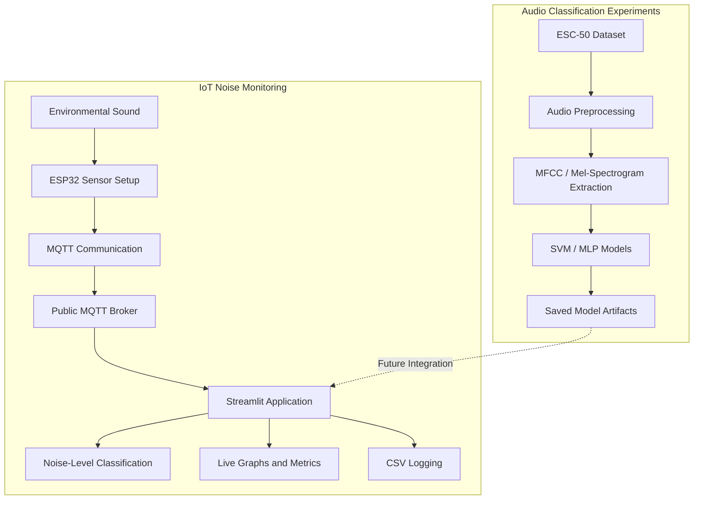

# NoiseIOT 🔊

### An IoT-Based Noise Monitoring and AI-Assisted Sound Analysis System

NoiseIOT is a project exploring the combination of **Internet of Things (IoT), real-time environmental noise monitoring, and Machine Learning-based audio classification**.

The project aims to monitor surrounding noise levels through an ESP32-based sensing setup, transmit readings using MQTT, and display them through an interactive Streamlit dashboard.

Alongside the IoT monitoring component, the project explores audio classification techniques using the ESC-50 environmental sound dataset, with the goal of extending basic noise monitoring into more intelligent sound analysis.

---

## 🎯 Problem Statement

Increasing environmental noise levels can affect health, concentration, comfort, and the overall quality of living.

Traditional noise monitoring systems may provide numerical readings without offering much context about the type of sound being detected.

NoiseIOT explores a system that can:

- Monitor environmental noise through an IoT-based sensing setup.
- Transmit readings to a monitoring dashboard in real time.
- Visualize noise variations and maintain historical records.
- Classify noise levels into understandable categories.
- Explore Machine Learning techniques for recognizing environmental sounds.

The long-term vision is to move beyond simply measuring noise intensity and towards understanding the nature of the surrounding sound environment.

---

## ✨ Key Features

### 1. IoT-Based Noise Monitoring

- ESP32-oriented sensor data collection.
- MQTT-based communication.
- Receives incoming noise readings through a subscribed topic.
- Supports continuous monitoring through a dashboard.

### 2. Live Noise Monitoring Dashboard

Built using Streamlit, the dashboard provides:

- Live noise readings.
- Dynamic noise-level visualization.
- Average, maximum and minimum readings.
- Noise classification indicators.
- CSV-based data logging and export.

### 3. Noise-Level Classification

The dashboard categorizes incoming readings into different levels.

| Noise Category | Description |
|---|---|
| Quiet | Relatively low noise |
| Moderate | Moderate noise levels |
| Loud | Elevated noise levels |
| Very Loud | High noise levels |

The current implementation uses threshold-based classification for these categories.

### 4. MQTT Communication

The application uses the MQTT protocol to receive data from the IoT device.

| Configuration | Value |
|---|---|
| Protocol | MQTT |
| Broker | test.mosquitto.org |
| Port | 1883 |
| Topic | `esp32/noise` |
| Payload | JSON containing a `sound` value |

### 5. Audio Classification Experiments

The project also explores Machine Learning-based environmental sound classification using the ESC-50 dataset.

The experiments include:

- MFCC-based audio feature extraction.
- Mel-spectrogram generation.
- Support Vector Machine classification.
- Multi-Layer Perceptron neural networks.

These experiments form the foundation for future AI-powered sound analysis.

---

## 🏗️ System Architecture

The project currently has two related development components: an IoT noise-monitoring pipeline and a separate audio-classification pipeline.



**Architecture note:** The audio-classification models are currently developed separately from the MQTT monitoring application. Connecting model inference to live audio or sensor data is a future development goal.

---

## 🧠 Machine Learning Approach

The project explores environmental sound classification using the **ESC-50 dataset**, a collection of environmental audio recordings.

### 1. Audio Dataset

ESC-50 provides environmental audio samples organized into 50 sound categories.

The project uses its metadata file, `esc50.csv`, to retrieve audio filenames and corresponding sound labels.

### 2. MFCC Feature Extraction

The MFCC-based experiments use the Librosa library to extract Mel-Frequency Cepstral Coefficients.

The workflow includes:

1. Loading audio recordings.
2. Converting audio into a suitable sample format.
3. Extracting 40 MFCC coefficients.
4. Calculating mean MFCC values across time.
5. Creating feature arrays for model training.

The resulting feature representation is used by the SVM and MLP experiments.

### 3. Mel-Spectrogram Processing

A separate experiment explores converting audio signals into mel-spectrogram representations.

The processing pipeline includes:

- Loading audio recordings.
- Converting stereo audio to mono.
- Resampling to 44.1 kHz.
- Generating Short-Time Fourier Transform representations.
- Applying a mel filter bank.
- Converting the result into log-mel spectrograms.
- Resizing spectrograms to 128 × 128.

These representations are saved for further experimentation.

### 4. Machine Learning Models

**Support Vector Machine (SVM)**

- Uses an RBF kernel.
- Configured with `C=10`.
- Trained using extracted MFCC features.
- Saved using Joblib.

**Multi-Layer Perceptron (MLP)**

The neural network uses:

| Layer | Configuration |
|---|---|
| Input | 40 MFCC features |
| Hidden Layer 1 | 256 neurons, ReLU |
| Dropout | 0.3 |
| Hidden Layer 2 | 128 neurons, ReLU |
| Dropout | 0.3 |
| Output | Softmax classification |

Training configuration:

- Optimizer: Adam
- Loss: Sparse Categorical Crossentropy
- Epochs: 30
- Batch size: 32

The trained model is saved in HDF5 format.

**Note:** These are separate experimental pipelines. Their saved models are not yet used by the live MQTT dashboard.

---

## 📊 Dashboard and Data Logging

The Streamlit application provides an interface for monitoring incoming noise readings.

### Dashboard Capabilities

| Feature | Description |
|---|---|
| Live Monitoring | Receives readings through MQTT |
| Noise Graph | Visualizes recent readings |
| Average Reading | Calculates average noise value |
| Maximum Reading | Displays the maximum observed value |
| Minimum Reading | Displays the minimum observed value |
| Noise Category | Shows the current threshold-based category |
| CSV Export | Saves collected readings for further analysis |

The dashboard also maintains recent readings in memory and supports exporting collected measurements as CSV files.

---

## 🛠️ Technology Stack

| Category | Technologies |
|---|---|
| IoT Hardware | ESP32-based setup |
| Programming Language | Python |
| Dashboard | Streamlit |
| Communication Protocol | MQTT |
| MQTT Client | Paho MQTT |
| Data Processing | Pandas, NumPy |
| Audio Processing | Librosa, SoundFile |
| Signal Processing | SciPy |
| Machine Learning | Scikit-learn |
| Deep Learning | TensorFlow / Keras |
| Models | SVM, MLP |
| Model Storage | Joblib, HDF5 |
| Dataset | ESC-50 |

---

## 📂 Project Structure

```text
NoiseIOT/
│
├── ai_model/
│   ├── features/
│   │   ├── features.npy
│   │   └── labels.npy
│   │
│   ├── models/
│   │   └── svm_model.pkl
│   │
│   ├── model_mlp.py
│   ├── model_s1.py
│   ├── model_s2.py
│   └── model_s3.py
│
├── app.py
├── app_we.py
│
├── noise_data_*.csv
│
└── .gitignore
```

### Main Files

| File | Purpose |
|---|---|
| `app.py` | Streamlit noise-monitoring dashboard |
| `app_we.py` | Alternative Streamlit dashboard with monitoring controls and MQTT integration |
| `model_mlp.py` | MFCC-based MLP audio-classification experiment |
| `model_s1.py` | Mel-spectrogram preprocessing pipeline |
| `model_s2.py` | MFCC feature extraction pipeline |
| `model_s3.py` | SVM model training and serialization |

---

## ⚙️ Getting Started

### Prerequisites

- Python 3.10 or compatible version
- pip
- ESP32-based noise sensing setup for live monitoring
- MQTT broker access

### 1. Clone the Repository

```bash
git clone https://github.com/SwathikaR-17/NoiseIOT.git

cd NoiseIOT
```

### 2. Create a Virtual Environment

```bash
python -m venv venv
```

Activate on Windows PowerShell:

```powershell
venv\Scripts\Activate.ps1
```

### 3. Install Dependencies

For the Streamlit monitoring application:

```bash
pip install streamlit pandas numpy paho-mqtt
```

For the audio-classification experiments, install the additional libraries:

```bash
pip install librosa scikit-learn tensorflow soundfile scipy tqdm joblib
```

### 4. Run the Noise Monitoring Dashboard

```bash
streamlit run app.py
```

Alternatively, run the dashboard with monitoring controls:

```bash
streamlit run app_we.py
```

The application subscribes to the configured MQTT topic and waits for incoming sensor readings.

### 5. MQTT Message Format

The application expects incoming messages in JSON format:

```json
{
  "sound": 1200
}
```

The ESP32 device must publish messages to the configured topic:

```text
esp32/noise
```

### 6. Audio Classification Experiments

The audio-classification scripts require the ESC-50 dataset.

Download the dataset and arrange it so that the scripts can access:

```text
ESC-50-master/
├── audio/
└── meta/
    └── esc50.csv
```

Run the relevant model scripts after updating their dataset paths to match your local setup.

---

## 🚀 Future Enhancements

- Integrate trained audio-classification models with the live IoT pipeline.
- Identify environmental sound categories in addition to measuring noise intensity.
- Develop real-time audio capture and preprocessing.
- Explore deep learning architectures for improved sound classification.
- Add intelligent alerts for sustained high noise levels.
- Build historical noise analytics and trend visualizations.
- Improve sensor calibration and convert raw readings into validated decibel measurements.
- Explore deployment on edge devices for low-latency inference.

---

## ⚠️ Current Scope and Limitations

NoiseIOT is an experimental project combining IoT monitoring and Machine Learning exploration.

The current implementation includes MQTT-based sensor reading reception, Streamlit visualization, threshold-based noise classification, and separate ESC-50 audio-classification experiments.

The following capabilities are not yet integrated into a complete system:

- Real-time AI sound classification from the ESP32 monitoring stream.
- Automatic identification of specific environmental sounds through the live dashboard.
- Calibrated sound-pressure measurements in decibels.
- A unified end-to-end IoT and AI inference pipeline.

The public MQTT broker is intended for experimentation and should not be considered a secure production communication setup.

---

## 👩‍💻 Author

**Swathi**

Computer Science Engineering | AI & Machine Learning

GitHub: [@SwathikaR-17](https://github.com/SwathikaR-17)

---

*NoiseIOT — Exploring intelligent environmental noise monitoring through IoT and Machine Learning.*
